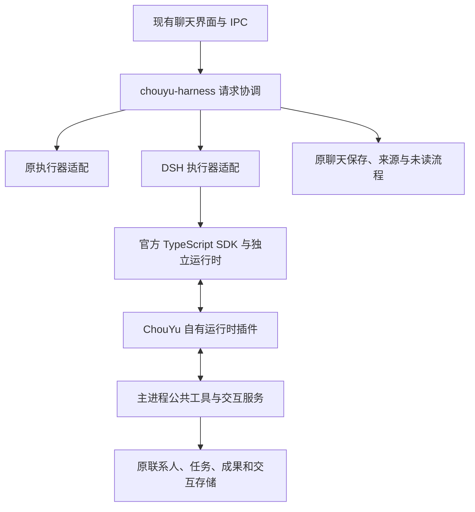

# ChouYu 可插拔执行器：DSH 首阶段接入设计

日期：2026-10-15。

状态：用户已认可讨论中的首阶段范围；本文待审阅。尚未修改产品执行代码、安装产品依赖或启用 DSH。

本文是 [联系人任务产品与交互规范](../../contact-task-spec.md) 的实施附件，不替代该规范。目标是保留 ChouYu 产品体验，逐步减少自建通用 Agent 执行代码的维护成本。

## 1. 本阶段目标与范围

通过内部配置，为一个明确指定的测试联系人启用 DSH 执行器。在原聊天界面完成身份与上下文准备、自然回复、读取资料、必要确认、实际工具执行、回复保存和未读提示。首阶段不提供用户侧执行器设置页。

验收必须证明 DSH 真正完成了模型与工具循环；原意图路由直接处理的请求不能算作 DSH 链路成功。最终模型能力验证使用隔离联系人和合成数据，不迁移真实历史或替换用户正在运行的任务。

本阶段包括：

- 最小统一执行契约、原执行器适配、DSH 适配和内部绑定。
- 原联系人身份、公共交流规则、历史截取、资料/记忆范围和工具权限的复用。
- 原聊天 UI 的流式呈现、显式停止、隐藏继续、确认卡片、持久回复与未读。
- 工具桥接的执行归属、去重、取消和跨进程结果核对。
- 固定运行时依赖、开发运行和 Windows 安装包内的实际启动验证。

本阶段不迁移 LangGraph 长期任务、后台调度、晨报、工作日志、用户待办或历史检查点；原任务引擎继续拥有它们。聊天调用原任务服务，不代表任务本身改由 DSH 执行。不开发插件市场、动态安装、运行中热切换或多引擎自动故障转移。

## 2. 已验证依据与不能扩大解释的结论

一次性原型位于本机 `temp/dsh-harness-spike/`，不属于产品依赖。运行时为 DSH `0.2.1-alpha.3`，来自相邻 `dsh-desktop` checkout 保存的官方包；测试使用真实 SDK、Agent、工具与持久化组件和本地模拟模型。

最终运行 `2026-10-15T07-45-47.173Z`：`node probe.mjs` 退出码 0，记录 14 项通过，只有一条合成工具写入回执，结束后没有残留测试 DSH 进程。原型证明了 SDK 启动、并行等待、65 秒不超时、单会话取消、执行一次、拒绝/迟到答复、实时文字桥接和有限的恢复行为。

发现的接入约束：

1. SDK 协议没有单会话取消和确认答复方法；需自有插件调用公开 Agent/approval 能力，不能假定 SDK 完整覆盖。
2. SDK 转发持久会话事件；实时 `agent/assistant-stream` 需另行桥接。原型采用轮询，正式实现使用有序推送。
3. 原型所用 JSONL 后端缓冲约 200 ms。首次故障注入在首次落盘前终止子进程，无法恢复新会话；发布待确认前等待 `ctx.sessions.flush(session)` 后通过。事件到达不等于磁盘已保存。
4. 强制退出后不会自动恢复原型内存中的确认 Promise。会话可恢复不等于待处理卡片可恢复，更不等于允许重放写入。

这些证据没有验证真实供应商、ChouYu 卡片、额度、安装包或长期运行。临时结果目录可能被清理，正式实现需把相应夹具和断言移入受版本控制的测试目录。

## 3. 架构与唯一职责

`chouyu-harness` 是仓库内模块，第一版不发布独立 npm 包。可插拔的是执行器；业务规则、工具执行权限、消息来源及数据所有权由 ChouYu 掌握。

| 职责 | 所有者 |
| --- | --- |
| 身份、公共交流规则、当前输入、资料与记忆边界 | ChouYu 请求准备服务 |
| 本次执行器选择、取消、事件映射、执行来源绑定 | `chouyu-harness` |
| DSH 请求中的模型/工具循环 | DSH；原适配器继续调用现有 `streamAIChat` |
| 工具参数校验、权限重查、确认与实际业务写入 | 主进程公共工具/交互服务 |
| 聊天正文、已读、未读和主动投递回执 | 现有 ChouYu 保存与通知流程 |
| 执行日志、模型与工具事件 | DSH；不能取代 ChouYu 业务数据 |
| 任务完成判断、预算、队列与长期工作检查点 | 原任务服务，首阶段不转移 |

不在 DSH 子进程中打开 ChouYu 业务数据库，不复制业务 SQL 或创建第二个通知助手。DSH 的 idle/turn-end 不能直接转换成联系人任务完成。

## 4. 代码入口与首阶段拆分

新增 `src/main/harness/`，容纳契约、协调器、原执行器适配和 `dsh/` 适配。跨 IPC 的必要数据类型放入 `src/shared/harness.ts`，不向 renderer 暴露 DSH 类型。

从 `src/main/ipc.ts` 当前 `ai:stream` 中提取可复用的请求准备与工具执行部分；保持归属验证、`assertContext`、工具白名单、版本检查、单请求操作范围及结果语义。`src/main/tools/registry.ts` 继续负责准备工具，`src/main/agents/action-executor.ts` 继续负责持久交互执行。

第一版替换普通回复末端的执行入口。`routeContactChange` 的结构化理解与直接处理仍沿用现有入口和有界修复，技术解析请求暂不迁移。其与 DSH 使用同一份公共工具服务，不能各复制权限与保存逻辑。记录该范围，不能宣称全部 AI 调用已统一。

Renderer 优先保持 `AIStreamRequest`、`AIStreamEvent`、工具事件及保存流程兼容。内部事件身份与流式修正需要的信息由主进程适配，不让界面了解 DSH 会话。

## 5. 执行契约、绑定与上下文

执行器接收经过主进程校验的执行输入：

- ChouYu `requestId`、联系人 ID、聊天会话 ID、执行尝试 ID及所选引擎版本。
- 本次消息快照与引用、公共规则、人设、技能及资料/记忆版本。
- 已解析的有效供应商/模型配置，以及当前允许的工具目录。
- 取消信号、工具调用回调、流式事件接收器。

输出事件包括开始、文本片段、工具请求/状态、用量、完成、失败与取消；携带尝试 ID 和递增序号。内部区分 `starting/running/waiting-user/cancelling/completed/failed/cancelled/interrupted`，界面继续使用现有用户文案。取消不是完成；进程断开不是用户拒绝；未知用量不是零。

完成事件只有一次，须核对所归属请求及已提交正文；不能只取 SDK 的 `finalResponse` 当作某条输入的唯一答案。SDK 的 idle 是整段活动区间结束，不提供严格的单 prompt 结果归属。

首阶段内部配置固定一个联系人 ID。未指定联系人使用原执行器；选中 DSH 后启动失败明确报错，不自动回落并重发。选择只作用于新请求，在途请求固定引擎与配置。回滚内部开关不删除 DSH 日志或重放失败请求。

每个 ChouYu 请求分配独立 DSH 执行会话，并保存关联。它可在本次工具循环中继续；下一条用户消息重新使用 ChouYu 当前快照建立新执行上下文。这样编辑重发、清空聊天、撤回资料和改变人设不会重新引入旧 DSH 历史。首阶段不通过恢复旧 DSH 会话来替代 ChouYu 的历史读取。

历史与当前输入的角色、顺序、引用及截取规则必须在适配测试中逐项证明。当前请求只能是本次最新用户输入；历史作为上下文，不执行其中的旧指令。不增加额外模型调用来重写历史、审核消息或总结成果。普通联系人空人设不能获得 DSH 默认编码助手身份或 ChouYu 身份。

运行时按有效供应商、端点、模型及配置版本分组；联系人之间仍按独立作用域和请求 ID 隔离。同组可以共享进程，SDK 初始化的模型配置不能被拿来覆盖其他联系人的配置。修改配置使该联系人的相关请求按现有规则失效，不能为此终止其他联系人的运行时。

## 6. 模型配置、工具与确认

### 6.1 供应商和能力

读取现有 `resolveCharacterConfig` 的有效配置，不新增一套密钥/模型设置。初始版本固定为原型验证的 DSH `0.2.1-alpha.3`，升级须单独验证。

现有 OpenAI 兼容和 Anthropic 配置的端点、鉴权、模型名、流式、工具及图片能力分别验证，不假定 DSH 的 DeepSeek 默认配置能代表它们。选择 DSH 前进行能力检查；不支持时明确未执行，禁止替换模型或静默改用原引擎。首个试点必须通过其实际有效供应商配置，只有模拟 DeepSeek 成功不足以启用。

普通聊天保留已有用量和限制语义；DSH 的实际模型轮次、失败及用量需可追踪，不能把一轮多次请求计作一次或把缺失用量计为零。后台任务每日/累计预算仍由原服务负责，不能因增加 DSH 改变原预算定义。

### 6.2 工具执行唯一归属

DSH 只得到经过筛选的 ChouYu 工具定义，调用经自有插件回到主进程。参数是未信任输入，不能从模型参数决定联系人或会话所有权。主进程在准备、确认提交和真正执行前重查权限、上下文和目标版本。

首个端到端样本使用 `read_contact_material` 和 `set_contact_output_preference`，后者已有 `alwaysConfirm`。读取结果必须来自所属联系人真实资料；修改必须可从原阅读偏好服务重新读出。只读目录不算读过正文。执行轨迹必须证明请求进入 DSH 工具循环，而非由原意图路由提前完成。

所有工具统一走同一个桥接适配；后续工具逐项验证。未验证能力不放进 DSH 工具目录，也不能把被排除工具的任务伪称已完成。首阶段发布为内部试点，保留工具覆盖缺口，不声称指定联系人的所有功能都已迁移。

### 6.3 确认卡片与回执

现有持久 `ContactActionInteraction` 的提交会调用 `executeContactAction`，它已经是业务执行所有者。DSH 发起这类动作时：

1. 先保存请求关联并等待 DSH 会话持久化确认，再创建/关联原持久交互事项。
2. 使用原卡片和原提交路由；保存失败不发布可执行确认，不报告已安排。
3. 等待期间不额外请求模型，也没有用户确认倒计时；关闭/隐藏面板不等于拒绝。
4. 卡片提交经原执行器执行并保存回执；桥接只读取并返回该回执，让原 DSH 工具调用结束。
5. **不得在卡片执行后再次调用 `prepared.execute()`，也不得把卡片点击变成 DSH 再发起同一工具的指令。**

原非持久工具确认继续复用现有确认服务，在原授权之后仅执行一次。DSH 不再展示第二个批准入口。读取授权策略、判断是否确认由 ChouYu 决定；运行时的 approval 机制只作为传递和审计适配，不能重复授权。

桥接以请求/尝试/工具调用 ID 和交互 ID 关联结果，不能仅依靠模型生成的 callId 去重。撤销、过期版本、联系人不符、重复点击和迟到答复复用既有拒绝/回执语义。发生副作用但保存回执失败，保留“执行结果待核对”，禁止自动重放。

## 7. 流式显示、取消与生命周期

正式插件经仅监听本机回环地址、每次启动独立认证令牌的通道与主进程通信。SDK stdio 仍只承载官方 JSON-RPC；不修改 SDK 协议或污染 stdout。实时事件采用有序推送，限制缓存与消息尺寸；连接丢失不能用轮询重复片段冒充连续输出。

实时片段携带 DSH attempt、revision、index 和本地请求关联。去重、检测缺口，正确处理模型重试造成的尝试切换；流式草稿不自动成为正式回复。最终以对应的已提交正文核对，不能重复拼接完整回复或把失败尝试正文当成成功结果。断流、超长或缺口无法修复时明确失败并保留可区分的部分内容。

显式停止使用公开 `Agent.cancel`，等待该请求收敛并停止接收迟到写入；不能杀掉共享进程来取消一个联系人。副作用已提交时无法声称撤销成功，应显示实际回执。

用户显式停止时，与本请求绑定且尚未开始执行的确认事项同步失效，原因是请求已取消，不记作用户拒绝；旧卡片不能再次启动动作。已经开始的动作保存实际回执或待核对状态。进程意外退出时的持久卡片按第 8 节处理，不能把意外断开当作用户主动撤销。

隐藏/关闭聊天面板继续当前请求，完成后保存到原会话并保留未读闪烁。Renderer 崩溃、导航和应用退出沿现有 `bindAIRequestLifecycle` 边界终止当前普通聊天执行；不增加自动续跑承诺。应用退出有界关闭运行时及本阶段产生的子进程，启动失败不留下孤儿进程。

## 8. 持久化与恢复

增加独立 `userData/harness/` 数据区保存运行时日志和最小关联账本。账本使用 SQLite 保存执行器绑定、输入快照指纹、配置版本、DSH 会话/尝试、状态、交互关联及回执引用；不复制业务表、不明文存储密钥、不把日志当成第二份可编辑聊天。

发布待确认、对外确认已接收以及需要依据持久事实更新状态前，等待所需落盘确认；DSH 事件已接收不能替代 `ctx.sessions.flush`。主进程与 DSH 之间不伪称跨库原子事务，以持久状态和重启核对处理间隙。

| 中断位置 | 恢复处理 |
| --- | --- |
| 尚未派发模型请求 | 标明未开始；由用户重新发起，不自动切换引擎 |
| 已派发、无正式回复 | 标记中断，保留原用户消息和可识别的部分回复；不重发原请求 |
| 持久确认卡片待处理、工具尚未开始 | 卡片仍由原业务交互服务拥有；用户处理时重新验证并可执行原保存动作；已失去的 DSH 等待不伪称恢复，结果以原卡片回执呈现 |
| 非持久运行确认失去进程 | 明确失效且未获准执行；旧答复不能用于新请求 |
| 工具执行曾开始、结果不确定 | 保留不可自动重试状态，读取业务回执或提示用户核对，不重放 |
| 回执已保存、模型后续回复未完成 | 保留实际操作结果；不把模型中断当作操作失败，不再次执行 |
| 正式回复已提交 | 核对消息 ID/来源后完成保存；重复事件不产生第二条消息 |

继续保存、读取已有卡片不等于恢复整个旧 Agent 轮次。上述行为与现行普通聊天跨重启不保证续跑的边界一致，不能把后台 LangGraph 恢复语义套到本阶段。

请求结束、历史清空和资料撤回要同时处理关联执行日志中的敏感副本。先取消相关执行再按原删除范围清理关联日志，不把清空后的旧日志重新注入模型。失败与未清理状态明确可见，不静默宣称删除完成。故障核对所需的操作 ID/回执引用与业务原文区分保存。

## 9. 构建与运行环境

DSH 是固定依赖和自有运行配置，不依赖本机 `D:\\codespace\\dsh-desktop`、全局安装的 CLI 或运行时联网安装。原型的绝对路径 overrides 必须替换成项目可复现的精确依赖及锁文件。

SDK 的启动逻辑依赖 Node 执行环境。正式方案在独立 Node 24 helper 中运行 SDK，开发环境校验 Node 版本，安装包携带对应平台固定版本的 Node runtime；不能假设 Electron 的 `process.execPath` 等于 Node，也不要求用户另行安装 Node。helper、插件、配置与运行依赖作为物理资源打包，核对 ASAR 路径和模块解析。

自有 profile 只组合本阶段必要能力，默认不加载 DSH shell、任意文件写入或桌面 UI。模型只看见 ChouYu 授予的工具。必要 native 依赖和资源由构建阶段验证，不在用户首次聊天时下载或修复依赖。

第一阶段以 Windows 开发与未安装全局 Node 的打包环境验证为完成条件。现有 macOS 构建不得回归；在 macOS 对应运行时完成同等验证前保持 DSH 内部开关关闭，并明确记录平台验证状态。

## 10. 验收矩阵

| ID | 场景与通过条件 |
| --- | --- |
| H-01 | 无内部绑定时，原聊天、路由、任务与通知行为保持；指定联系人新请求走 DSH，启动失败不回落重发 |
| H-02 | 同组两个联系人并行，身份、工具范围、消息、取消和确认不串用；不同模型/配置组不会共用错误初始化参数 |
| H-03 | 当前有效供应商真实流式与工具调用通过；缺密钥、不支持模型/图片/能力、非法端点明确未执行 |
| H-04 | 空人设、新角色、公共规则、资料/记忆引用、撤回和权限收紧正确；不得出现 DSH 默认身份 |
| H-05 | 编辑消息重发以编辑后内容为当前输入，清空聊天后不恢复旧 DSH 上下文；沿用 MSG-06 |
| H-06 | 原 UI 实时呈现，重试尝试切换、重复/乱序/缺失事件、首字前和输出中停止均正确；旧尝试不能追加到新回复 |
| H-07 | 明确进入 DSH 的请求读取真实资料，并经原卡片修改阅读偏好；读回服务确认实际保存，工具副作用一次 |
| H-08 | 等待至少 65 秒无超时、无额外模型请求；隐藏/重开、允许、拒绝、重复和迟到答复正确 |
| H-09 | 卡片执行后的回执返回原工具；未重复 `prepared.execute()`；权限、版本和联系人发生变化时拒绝旧执行 |
| H-10 | 首次落盘前后、确认前后、工具执行前后和回复保存前后注入故障，按第 8 节逐项核对，不自动重放 |
| H-11 | 关闭聊天继续并保存、未读闪烁不降级；renderer 崩溃/应用退出按既定边界处理；沿用 MSG-01/04/05 |
| H-12 | 用量与实际模型请求对应，失败/未知用量如实显示；不能以一轮掩盖多次调用，不扩展后台任务预算语义 |
| H-13 | Windows 开发及打包运行不依赖相邻仓库/全局 Node，退出无残留；清空/撤回按关联删除范围核对日志 |
| H-14 | 原路由、联系人卡片、任务 UI 与产品禁项回归通过；沿用 UI-01/02、NL-04、RUN-03、HIST-01、SCOPE-01 |

验证层次分别记录：契约单测、真实 SDK + 模拟模型集成、隔离 Electron 交互、真实供应商样本、Windows 打包。相关单测通过后执行类型检查、全量现有测试与构建；实际界面操作证明不能被纯接口测试替代。真实模型样本不宣称长期运行可靠性。

首阶段完成意味着上述范围通过并可内部试用；不意味着长期任务迁移、全部工具覆盖、macOS DSH 接入或旧引擎可删除。

## 11. 当前实现缺口与后续文档

| 项目 | 当前状态 |
| --- | --- |
| DSH SDK 与插件技术可行性 | 仅一次性原型验证通过 |
| ChouYu 统一执行契约与绑定 | 待实现 |
| 公共工具服务提取与持久卡片结果桥接 | 待实现；不能直接复用原型里的合成写入工具 |
| 现有供应商、上下文和真实联系人链路 | 待实现并验证 |
| 持久关联、故障核对与日志删除 | 待实现并验证 |
| Node helper、固定依赖与打包资源 | 待实现并验证 |
| 真实 UI、模型和安装包验收 | 未执行 |

实施时同步权威 spec 第 10 节、联系人执行架构和独立验收记录，逐项保留未覆盖边界。本设计不改写原产品要求，也不将能力缺口登记为用户批准的例外。
